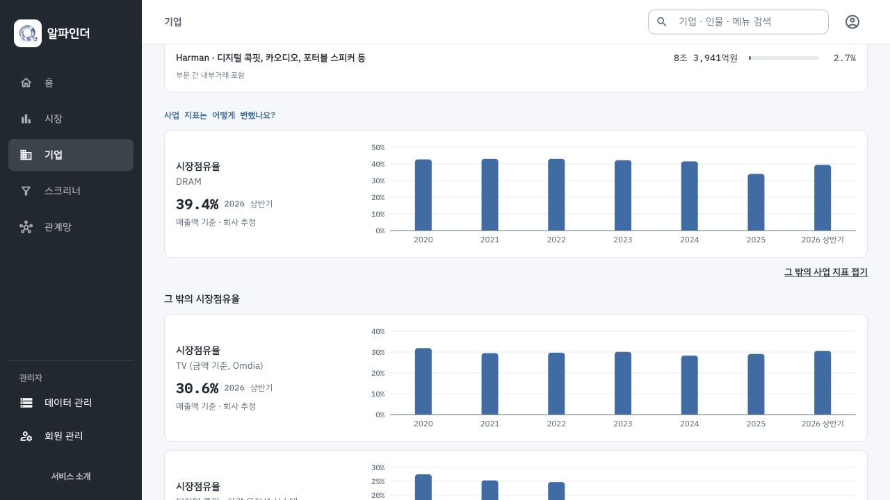
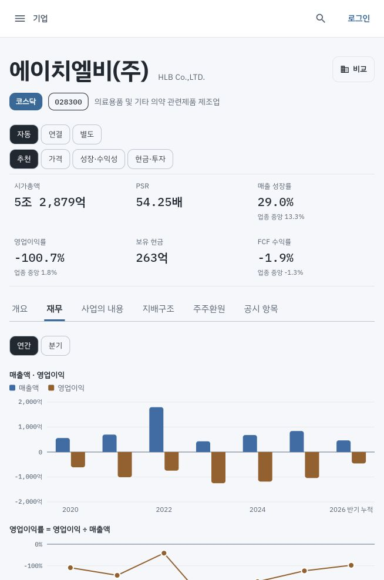
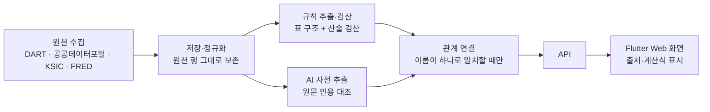

# 알파인더 투자 온톨로지

**한국 상장사 2,759곳의 재무·사업·지분 관계를 공시 근거와 함께 연결한 투자 리서치 웹 서비스입니다.**

혼자 기획하고, Claude Code와 함께 만들고, 직접 운영했습니다. 2026년 9월 17일부터 10월 16일까지 커밋 890개를 쌓았습니다.

> **현재 상태:** 2026년 10월까지 alfinder.kr에서 운영했고, 지금은 서버를 내렸습니다. 아래 화면은 2026년 9월 30일 운영 화면입니다.

<table>
  <tr>
    <td width="62%"></td>
    <td width="38%"></td>
  </tr>
  <tr>
    <td>사업의 내용 탭. 사업보고서 표에서 규칙으로 읽은 시장점유율을 연도별로 보여 줍니다.</td>
    <td>모바일 재무 탭. 지표를 누르면 계산식과 입력값이 열립니다.</td>
  </tr>
</table>

## 한눈에

| 항목 | 내용 |
|---|---|
| 역할 | 1인 기획·설계·개발·배포·운영 |
| 기간 | 2026.09.17 – 2026.10.16 (커밋 890개, 그중 256개는 Claude와 공동 작성) |
| 데이터 범위 | 상장사 2,759곳 전체를 최소 한 개 사업군에 분류 (누락 0) |
| 숫자 검증 | 재무 원천 990,048행과 파생 지표 176,157개를 독립 검산해 불일치 0 |
| AI 추출 | 사업보고서에서 공급·매출·경쟁 관계 1,060건 추출, 원문에 없는 근거 0건 |
| 테스트 | 테스트 파일 636개, 서버 테스트 10,205개 통과 |
| 스택 | Flutter Web · Serverpod · PostgreSQL · Anthropic Messages API · Docker · Cloudflare Pages |

## 어떤 문제를 풀려고 했나

개인 투자자가 기업을 조사할 때 부딪히는 질문은 네 가지였습니다.

1. **살펴볼 만한 기업은 어디인가?** 업종과 수익성·성장률·밸류에이션 조건으로 후보를 좁힙니다.
2. **무엇으로 돈을 벌고, 실적은 어떻게 변했나?** 재무 추이와 함께 부문별 매출, 수주잔고, 가동률처럼 사업보고서 본문에만 있는 지표를 봅니다.
3. **누가 소유하고, 어떤 기업과 연결되어 있나?** 주주·임원·출자 관계와 공급·매출·경쟁 관계를 따라갑니다.
4. **이 숫자를 어디까지 믿을 수 있나?** 모든 숫자에 원천 공시, 기준 기간, 계산식을 붙입니다.

마지막 질문이 설계 전체를 정했습니다. **숫자는 원천 공시에서만 가져오고, 모든 사실에 출처(`Source`)를 붙인다**는 원칙입니다.

## 내린 판단들

기능보다 무엇을 하지 않을지를 더 자주 정했습니다. 결정은 [AGENTS.md](AGENTS.md)에 날짜와 함께 남겨, AI와 함께 일할 때도 같은 기준을 따르게 했습니다.

| 결정 | 이유 | 대가와 결과 |
|---|---|---|
| **AI는 화면 요청 때 부르지 않는다** | 요청마다 부르면 비용과 지연이 커지고, 결과를 검증할 틈이 없습니다 | AI 결과는 미리 만들어 저장하고, 화면은 저장된 값만 읽습니다. 비용이 드는 추출 배치는 관리자가 직접 시작할 때만 돕니다 |
| **AI 근거 인용이 원문과 글자 그대로 같을 때만 저장한다** | 그럴듯한 관계를 지어내는 것을 막을 확실한 방법이 원문 대조였습니다 | AI 관계 1,060건을 원문에 없는 근거 0건으로 적재했습니다. 모델이 말한 확신도와 실제 대조 정확도는 따로 기록합니다 |
| **사람이 하나씩 검수하는 큐를 없앤다** (2026-09-22) | 혼자 운영하면 사람이 병목입니다 | 규칙 추출과 자동 대조를 우선했습니다. 애매한 건만 추천과 이유 메모를 붙여 남기고, 측정한 정확도를 화면에 표시합니다 |
| **수집 범위를 최근 5년 연간 + 최신 중간 보고서로 제한한다** (2026-10-02) | DART API 하루 한도 안에서 전 종목을 고르게 채우는 게 10년치 일부보다 낫습니다 | 10년으로 자동 확장하지 않고, 이미 받은 과거 자료는 지우지 않습니다 |
| **공용 데이터는 로그인 없이 공개하고, 변경은 관리자만** (2026-10-01) | 처음 온 사람이 바로 탐색해 봐야 가입할 이유가 생깁니다 | 개인 기능만 이메일 인증을 요구하고, 모든 변경 요청은 서버에서 관리자 권한을 검사합니다 |
| **지분 묶음 화면을 내린다** | 투자자가 이 화면으로 무엇을 결정할지 시나리오가 없었습니다 | 메뉴와 검색에서 숨기고, 저장 데이터와 구현은 남겨 다시 기획할 때 씁니다 |
| **공시 숫자의 단위를 바꾸지 않는다** | 공시마다 단위가 다르고(원, 백만원, 백만 달러, 배치), 확인하지 않은 변환은 검산을 통과하는 틀린 숫자를 만듭니다 | 공시에 적힌 단위 그대로 저장하고, 화면에서만 읽기 쉽게 표시합니다 |

## 틀렸던 것과 다시 막은 방법

검증 규칙을 통과했는데도 틀린 경우가 가장 위험했습니다. 실제로 겪은 사고와 고친 방법입니다.

- **3년 전 숫자가 검산을 통과했다.** 공시 표는 당기·전기·전전기를 나란히 적습니다. 마지막 칸을 읽었더니 삼성물산 상사 부문 매출 20.2조 원이 13.2조 원으로 저장됐고, 비중 검산도 통과했습니다. 이제는 열을 헤더 이름으로 고르고 행마다 오른쪽 끝에서 다시 찾으며, 회귀 테스트로 고정했습니다.
- **느슨한 규칙이 쓰레기 관계 1,135건을 만들었다.** '거래처·고객사' 같은 넓은 헤더를 허용하자 판매경로·결제조건 표가 관계로 들어왔습니다. 정확히 '매입처'라고 적힌 열만 쓰도록 좁히고, 규칙을 다시 돌릴 때마다 새 행을 눈으로 확인합니다.
- **단위를 못 찾으면 값을 통째로 버렸다.** 생산능력 표에서 단위를 확정하지 못하면 가동률까지 버리고 있었습니다. 단위가 필요 없는 가동률은 남기도록 바꿔 가동률을 가진 기업이 51곳에서 85곳으로 늘었습니다.
- **함수 하나의 조기 반환이 부문별 매출을 숨겼다.** 가동률 표가 없으면 저장 함수가 일찍 끝나, 약 100개 기업의 부문별 매출이 빠져 있었습니다. 저장 순서를 고치고 같은 경우를 테스트로 남겼습니다.

## AI와 함께 일한 방식

코드와 데이터 작업 대부분을 Claude Code에 맡겼습니다. 대신 결과가 틀렸을 때 피해가 큰 지점은 기준을 직접 정하고 코드로 강제했습니다.

| 맡긴 일 | 직접 정하고 확인한 것 |
|---|---|
| 기능 구현과 테스트 작성 | 무엇을 만들지, 설계 판단, 배포 여부 |
| 사업보고서에서 관계·지표 추출 | 근거 인용 원문 대조 규칙, 추출을 돌릴지 말지 (비용이 드는 배치는 자동 실행하지 않음) |
| 공시 표 추출 규칙 작성 | 검산 조건(예: `가동률 ≈ 생산실적 ÷ 생산능력`), 실제 공시로 결과를 다시 확인 |
| 반복 작업 절차 | [AGENTS.md](AGENTS.md)에 금지 사항과 결정 이유를 적어 매 세션 같은 기준을 따르게 함 |

## 데이터를 어떻게 믿을 수 있게 했나



- **원천은 지우지 않는다.** DART 응답은 행 단위로 그대로 보존하고, 정정 공시는 이전 기록을 대체 관계로 연결합니다.
- **파생 지표는 저장하지 않는다.** PER·ROE·TTM은 원천 값에서 계산하고, 화면에서 계산식과 입력값을 보여 줍니다.
- **표는 산술로 검산한다.** 부문 매출은 공시된 비중과, 수주는 `수주총액 = 기납품액 + 수주잔고`와, 연구개발비는 공시된 매출 대비 비율과 맞을 때만 받습니다.
- **이름 연결은 보수적으로 한다.** 정규화한 이름이 상장사 하나와만 일치할 때 연결하고, 추정 연결은 화면에서 점선으로 구분합니다.
- **검증 통과가 무오류를 뜻하지 않는다고 적는다.** 형식이 다르거나 단위·대상을 확정할 수 없는 값은 추출하지 않습니다.

## 기술 구성

```text
investment_ontology_serverpod_flutter/   Flutter Web 화면 (기능별 features/, 디자인 토큰 design/)
investment_ontology_serverpod_server/    Serverpod API와 PostgreSQL
  lib/src/ontology/
    ingest/        원천 수집, 하루 API 예산, 중단 지점부터 재개하는 예약 작업
    disclosure/    공시 표 규칙 추출, 관계 연결
    ai/            사전 추출, 원문 인용 대조, 제출
    endpoints/     화면이 쓰는 API
investment_ontology_serverpod_client/    자동 생성 Dart API 클라이언트
docs/                                    설계 문서와 작업 기록
```

Flutter와 서버는 Serverpod가 생성한 타입 기반 클라이언트로 통신합니다. 화면은 디자인 토큰과 공통 컴포넌트만 쓰도록 테스트로 강제합니다.

## 로컬에서 실행

Dart SDK `^3.13.4`, Flutter `^3.47.5`, Serverpod CLI `4.0.0`, DART OpenAPI 인증키, 공공데이터포털 서비스키가 필요합니다.

```bash
flutter pub get --enforce-lockfile
dart pub global activate serverpod_cli 4.0.0
```

`investment_ontology_serverpod_server/config/passwords.yaml`의 `shared:` 아래에 키를 넣거나, 환경변수 `DART_API_KEY`, `DATA_GO_KR_SERVICE_KEY`를 설정합니다. 이 파일은 Git에서 제외됩니다.

```bash
cd investment_ontology_serverpod_server
serverpod start
```

앱은 [localhost:8100](http://localhost:8100), API는 `localhost:8080`에서 열립니다. 테스트는 Docker 없이 내장 PostgreSQL로 돌아갑니다.

```bash
bash scripts/test-server.sh
```

관리자 설정, 첫 데이터 수집 순서, 화면별 기능은 [제품 안내서](docs/product-guide.md)에 정리했습니다.

## 더 읽을 거리

| 문서 | 내용 |
|---|---|
| [제품 안내서](docs/product-guide.md) | 화면별 기능, 사용 흐름, 데이터 원천, 로컬 실행 전체 절차 |
| [온톨로지 설계](docs/ontology-design.md) | 데이터 모델과 전체 설계 |
| [재무 원천 검산 기록](docs/metric-source-audit-2026-09-30.md) | 990,048행 대조와 176,157개 지표 검산 |
| [인수인계 검증 기록](docs/handoff-acceptance-2026-09-22.md) | 검증 범위와 재현 절차 |
| [작업 기록](docs/handoff.md) | 과거 결정, 사고, 후속 작업 |
| [프로젝트 지침](AGENTS.md) | 구현 규칙과 AI 에이전트 작업 절차 |
