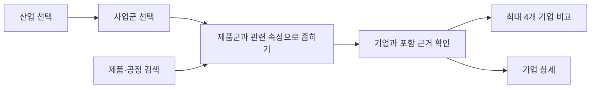

# 업종지도: 기업 발견과 비교를 연결하는 설계안

> 2026-10-01 갱신: 최신 검토본은 [기업 발견 분류 v2](industry-discovery-v2-design.md)다. 아래 제품 검색 진입과 혼합 role 구현 방향은 대체되었다. 과거 기록으로 보존한다.

작성: 2026-10-01. 상태: 제안. 이번 작업은 설계이며 운영 코드·DB·분류 결과는 변경하지 않았다.

## 1. 목적과 판단 기준

주목적은 **관심 산업에서 조사할 기업을 발견하고, 같은 사업을 기준으로 비교 후보를 고르는 것**이다. 시장 규모 파악은 보조 목적이다. “같은 업종에 속함”은 탐색의 출발점이며 직접 경쟁·동일 밸류에이션 적용을 의미하지 않는다.

사용자 질문 세 가지를 지원한다.

1. 반도체에 어떤 종류의 기업이 있나? → 산업과 사업군을 둘러본다.
2. 패키지기판을 검사하는 장비 업체는 어디인가? → 제품군과 적용 대상을 선택한다.
3. 이 기업과 무엇이 비슷하고 다른가? → 같은 사업 기준으로 비교 후보를 확인한다.

최적성은 아직 사용자 실험으로 입증하지 않았다. 아래 구조를 구현 후보로 삼고, 실제 기업 찾기 과제와 분류 정확도를 검증한다.

## 2. 선택한 구조

**얕은 탐색 계층 + 제품 단위의 다차원 속성 + 근거를 공유하는 피어 후보**를 사용한다.

| 구조 | 장점 | 한계 | 선택 |
|---|---|---|---|
| KSIC 이름만 짧게 표시 | 빠르고 공식 코드에 일치 | 공정·제품·역할 차이를 해결하지 못함 | 공식 정보 열람용 |
| 모든 기업을 하나의 깊은 트리에 배치 | 집계가 간단 | 다사업 기업, 여러 공정 제품, 다른 탐색 순서를 수용하기 어려움 | 기본 탐색 경로만 활용 |
| 자유 태그만 제공 | 유연함 | 용어 중복, 진입점 부재, 비교 근거 불명확 | 채택하지 않음 |
| 산업 → 사업군 → 제품군, 공정 등은 속성 | 쉬운 진입과 정밀 탐색을 함께 제공 | 출처 연결과 속성 규칙 필요 | 권고안 |

탐색 계층의 기본 깊이는 3단계다. 사용자가 제품명으로 검색하면 바로 제품군에 진입한다. 모든 단계를 거쳐야 기업이 보이는 구조로 만들지 않는다. 산업을 선택한 순간부터 기업 목록을 함께 보여준다.

기본 흐름:



공정부터 시작하고 싶은 사용자는 산업 안에서 ‘공정으로 찾기’를 사용할 수 있다. 동일 데이터의 다른 진입점이며 별도 분류체계를 만들지 않는다.

## 3. 분류 단위: 회사보다 회사의 제품·사업 활동

회사는 여러 제품·사업 활동에 연결된다. 각 활동에 역할·제품군·대상·공정·기술·사업 모델을 묶어서 기록한다.

예: `회사 → 제품 A → 검사 장비 / 광학 검사 / 패키지기판 대상`.

회사의 태그를 한데 모아 단순 AND 검색하면 안 된다. 제품 A가 ‘웨이퍼 검사’, 제품 B가 ‘패키지기판 수리’인 회사에서 ‘패키지기판 검사’를 만들어내는 오류가 생긴다. 필터와 피어 선정 조건은 **같은 활동 또는 같은 제품의 근거 묶음**에서 충족해야 한다.

| 축 | 용도 | 반도체 예시 |
|---|---|---|
| 산업 | 진입점 | 반도체 |
| 사업군 | 무엇을 팔고 어떻게 돈을 버는가 | 칩 설계·판매, 위탁생산, 장비, 소재, 부품, 패키징·테스트 서비스 |
| 제품·서비스군 | 비교 후보를 좁히는 중심 단위 | 식각 장비, 증착 장비, 검사 장비, 테스트 소켓 |
| 적용 대상 | 무엇을 가공·검사·지원하는가 | 웨이퍼, 패키지기판, 완성 패키지 |
| 공정·기능 | 어디에서 어떤 일을 하는가 | 증착, 식각, 세정, 접합, 검사·계측, 전기적 테스트 |
| 기술·방식 | 제품군 내부 차이 | 광학, X선, 전기적 방식 등 |
| 사업 모델 | 경제적 차이 확인 | 제품 판매, 위탁생산, 개발·라이선스, 서비스 |
| 노출·비중 | 그 사업이 얼마나 중요한가 | 공시된 제품/부문 매출과 비중; 없으면 미확보 |

위 예시는 분류 설계용이며 개별 기업의 실제 분류나 완성된 산업 표준을 뜻하지 않는다. 공정은 반복·병렬·횡단하므로 단일 일방향 생산 흐름으로 강제하지 않는다. 검사·계측을 마지막 단계 한 곳에만 배치하지 않는다.

## 4. 얼마나 세분화할 것인가

“같은 구매 목적을 충족하는 유사 제품·서비스인가”를 중심으로, 다음 차이가 비교 판단을 바꿀 때 나눈다.

- 판매자와 구매자 역할이 다름: 칩 제조와 칩 제조 장비.
- 제품·기능 또는 적용 대상이 다름: 광학 외관 검사와 전기적 성능 테스트.
- 사업 모델이 다름: 브랜드 판매와 수탁생산.
- 근거로 일관되게 구분할 수 있고 사용자가 구분을 이해할 수 있음.

기술 세부 사양 하나마다 새로운 지도 칸을 만들지는 않는다. 대체 가능성이나 수요 구조 차이를 설명하는 세부 기술은 먼저 필터와 차이 설명으로 둔다. 기업 수를 맞추려고 의미가 다른 집단을 합치거나 쪼개지 않는다.

화면의 초기 설계 가설은 다음과 같다. 수치는 데이터 분석·사용성 검증 후 조정한다.

- 한 화면에 6~12개 정도의 주요 하위 항목을 노출하고 나머지는 펼친다.
- 비교 후보는 대개 3~8곳이면 읽기 편하지만, 이는 분류의 정의나 최소 기업 수가 아니다.
- 국내 상장사가 1곳이면 1곳으로 유지하고 ‘현재 범위 내 추가 후보 없음’을 표시한다.
- 하위 분류가 1개뿐이면 불필요한 클릭 단계를 건너뛰되 원래 경로를 표시한다.
- 의미가 다른 기술은 작은 집단이어도 유지한다. 근거가 부족한 세부 분류는 ‘세부 정보 미확보’로 남긴다.

산업마다 중요한 세부 축은 달라야 한다. 반도체는 역할·제품·공정·대상, 제약·바이오는 개발/제조 모델·제품/기술·개발 단계, 소프트웨어는 고객 업무·제품·수익 모델 같은 축을 검토한다. 이 예시는 설계 방향이며 이번 범위에서 다른 산업의 완성 분류를 주장하지 않는다.

## 5. 반도체 탐색 예시

```text
반도체
 ├ 칩 설계·판매 / 제조 / 위탁생산
 ├ 장비
 │  ├ 증착 장비
 │  ├ 식각 장비
 │  ├ 세정 장비
 │  ├ 검사·계측 장비 → 대상·방식으로 좁히기
 │  ├ 패키징 장비
 │  └ 테스트 장비
 ├ 소재
 ├ 부품·소모품
 ├ 패키징·테스트 서비스
 └ 설계 도구·IP
```

초기 구조의 예시이며 빠진 제품은 출처 기반으로 확장한다. ‘칩 설계·판매 / 제조 / 위탁생산’도 실제 탐색에서는 각각 구분하고, 수직 통합 기업은 여러 활동으로 연결한다. 패키지기판 등 인접 공급망의 포함 범위는 산업 정의에 명시한다. 단순히 고객이 반도체 회사라는 이유로 모든 공급사를 반도체 피어에 포함하지 않는다.

구체적인 경로:

`반도체 → 장비 → 검사·계측 → 대상: 패키지기판 → 방식: 광학 → 기업 목록`

‘같은 공정의 소재·부품 보기’는 인접 기업 탐색이다. 장비와 소재를 기본 비교 후보에 섞지 않는다. HBM 같은 제품·응용 용어로 진입해도 제조, 장비, 소재 역할을 구분해서 보여주며, 관련성만으로 피어를 만들지 않는다.

## 6. 피어 후보 선정

고정된 회사별 피어 명단 대신 **선택한 사업 기준**으로 후보를 만든다. 기존 최대 4개 기업 비교와 연결한다.

1. 같은 제품·서비스군과 양립 가능한 역할/사업 모델이 확인된 활동을 찾는다.
2. 장비라면 적용 대상과 기능을 확인하고 필요한 경우 기술 방식도 일치시킨다.
3. 같은 공정에만 속하는 기업은 ‘관련 기업’, 같은 산업에만 속하면 ‘같은 산업’으로 별도 표시한다.
4. 매출 비중·고객·최종 수요·설비투자 의존도는 확인된 값으로 차이를 설명한다. 미확보를 불일치로 간주하지 않는다.
5. 근거 적합도가 같으면 공시 최신성, 확인된 사업 비중 등을 사용한다. 임의 유사도 백분율은 노출하지 않는다. 시가총액은 사용자가 선택하는 정렬이다.

카드에는 `공통점: 무엇을 하는 제품인가`, `차이: 다른 제품/적용 범위`, `해당 사업 비중: 확인값 또는 미확보`를 짧게 표시한다. 공시 근거·기준 기간은 펼쳐 본다. 직접 경쟁을 확인하지 않았다면 ‘직접 경쟁사’라고 부르지 않는다.

사업 기준으로 후보를 골라도 PER·시가총액·재무비율은 기업 전체 값이다. 다사업 기업의 전체 실적을 특정 사업 실적으로 표현하거나, 제품 매출 비중으로 시가총액을 나누어 사업 가치를 만들지 않는다. 연결/별도·기준 기간 차이를 비교 화면에서 확인할 수 있게 한다.

## 7. 화면과 집계

### 탐색 화면

- 첫 화면: 익숙한 산업명 카드 + 산업/제품/공정 검색. 작은 기업도 찾기 쉬운 일정한 크기의 카드가 기본이다.
- 산업 화면: 사업군 카드, 현재 필터, 기업 목록을 동시에 제공한다.
- 세부 화면: 해당 사업에 유효한 속성만 노출한다. 모든 산업의 모든 필터를 한꺼번에 보여주지 않는다.
- 기업 행: 이름, 주요 제품, 현재 분류에 포함된 이유, 사업 비중/미확보, 기업 시가총액, 비교 추가.
- 비교 선택은 화면을 이동해도 유지하며 최대 4곳. 기업명 클릭은 상세, 비교 버튼은 선택만 수행한다.
- 모바일은 세로 목록과 필터 시트, 선택 요약 칩을 사용한다. 전체 페이지와 지도 사이 중첩 스크롤을 피한다.
- 선택 상태와 검색어는 URL에 남기고, 상세에서 뒤로 오면 필터·스크롤·선택을 복구한다.
- 공개 탐색·비교를 유지하고 관심기업 저장 등 개인 기능에서 가입을 유도한다.

### 시가총액 지도의 위치

기존 KSIC 시가총액 지도는 ‘시장 규모 보기’로 유지한다. 사업 탐색의 다중 소속을 단일 분할 면적처럼 표현하지 않는다.

- 탐색 카드의 기업 수는 카드 안에서 중복 제거한다. 카드 사이 중복 가능성을 짧게 표시한다.
- 필터 결과에서는 corpCode로 중복 제거한 회사 목록과 합계를 사용한다. 동일 기준일과 기존 증권 집계 규칙을 적용한다.
- 결과 기업 시가총액 합계는 ‘선택 조건에 해당하는 기업 전체 시가총액’이지 해당 산업/제품의 시장 규모가 아니다.
- 제품·공정별 중복 소속 카드에는 서로 더할 수 있는 시가총액 비중을 표시하지 않는다.
- 기업 결과의 트리맵 보기는 가능하되 기업당 한 타일이고 목록과 동일한 집합을 사용한다. 면적만으로 탐색 우선순위를 결정하지 않는다.
- ‘대표 업종’ 한 칸을 정하기 위해 매출 비중을 추측하지 않는다. 공식 KSIC 대표 업종과 다중 사업 분류는 각자의 목적에 맞게 사용한다.

### 빈 결과와 정보 부족

`기업 없음`, `분류 근거 미확보`, `원문 미수집`, `규칙 처리 대기`, `과거 자료만 있음`을 구분한다. 필터 결과 0개에서는 어떤 조건을 풀면 결과가 생기는지 제시하고 자동으로 범위를 넓히지 않는다. 필터 개수는 같은 필터 내 OR, 서로 다른 축 간 AND 기준이며 제품 활동 단위로 계산한다.

## 8. 근거·데이터 구조

KSIC는 공식 분류로 명칭·코드·개정판을 유지한다. 탐색용 산업/제품 사전은 Alfinder 자체 구조라고 표시한다. GICS는 설계 참고이며 분류 데이터의 도입·복제 권한이 확보됐다고 가정하지 않는다.

제안 모델(아직 생성/마이그레이션하지 않음):

- `IndustryConcept`: 안정적 ID, 표시명, 정의, 포함/제외 조건, 부모, 동의어, 사전 버전.
- `BusinessActivity`: 기업, 제품/서비스명, 산업·사업군·제품군, 활동 상태, 원문 대상 범위(연결/별도/자회사).
- `ActivityAttribute`: 활동, 축, 값, 근거. 다른 활동의 태그를 합성하지 않는다.
- `ClassificationEvidence`: Source/문서/접수번호, 원문 위치와 인용, 보고기간, 규칙 ID·버전, 추출 시각, 검증 종류.
- `ActivityRevenueLink`: 기존 공시 매출 근거와의 명시적 연결, 기간·단위·기준·범위. 정합성이 검증될 때만 비중을 제공한다.

사전의 의미 구조와 기업의 분류 사실을 분리한다. 제품 별칭/명시적 표 값으로 자동 검증 가능한 연결부터 활성화한다. 키워드가 원문에 존재한다는 이유만으로 공급·판매 활동으로 확정하지 않는다. 고객/경쟁사 제품, 구매·도입 장비, 연구개발 예정, 원재료, 자회사 활동을 자신의 상용 제품과 구분한다.

원문 일부 수동 열람은 설계와 규칙 테스트용이다. 기존 사용자 정책에 따라 AI/수동 사실 제출·정기 검수 대기열은 재개하지 않는다. 규칙이 의미를 확정하지 못하면 더 넓은 근거 있는 분류로 남기거나 해당 축을 미확보로 표시한다.

정정 공시는 새 근거로 교체하고 이전 이력을 남긴다. 재분류는 규칙/사전 버전에 귀속시키며 최신 공시 미확보 시 오래된 근거의 기간을 표시한다. 숫자의 산술 검산과 분류의 의미 정확도는 별도 지표다.

## 9. 현재 코드와 연결 지점 — 이번에 확인한 내용

- `market_endpoint.dart`와 `market_cap_treemap_section.dart`: KSIC 대분류·중분류와 기업 시가총액 탐색이 있다.
- `peers/product_taxonomy.dart`: 주요 제품 칸을 제품 키로 변환하며 장비·소재를 완제품과 혼동하지 않도록 제외한다.
- `peers/peer_rules.dart`: 규칙 v7. 일부 검사 대상·방식과 공통 제품으로 후보를 찾는다. 일반 제품 경로는 KSIC 앞 두 자리 일치도 요구한다.
- `peers/peer_catalog.dart`: 원문에서 미리 계산한 `PeerProfile`을 조회한다. 최신 연간 원문·규칙 버전 조건과 후보 상태를 제공한다.
- `PeerSignal`은 key/label/evidence, `PeerProfile`은 문서 단위 signals이므로 제품별 속성 결합을 표현하기에는 부족하다.
- `peer_candidates_panel.dart`: 제품 기준 선택과 공통점·차이·원문 표시를 재사용할 수 있다.

기존 신호는 초기 후보와 회귀 기준으로 활용한다. 문서 전체 신호를 자동으로 새 제품 활동의 확정 근거로 옮기지 않는다. 장비 분류 확장은 완제품용 제외 규칙을 제거하는 대신 별도 역할 인식 경로로 만든다. 장기적으로 명시적 활동 근거가 충분하면 KSIC 2자리 일치를 절대 배제 기준에서 보조 정보로 바꾸되, 검증 전에는 기존 규칙을 유지한다.

과거 문서의 커버리지 수치는 현재 운영 DB 수치로 재확인하지 않았다. 이번 설계는 라이브 DB의 분류 커버리지나 기업별 배치를 검증했다고 주장하지 않는다.

## 10. 실행 순서와 출시 판단

1. 반도체 사전: 각 제품군의 포함/제외 정의와 필터 축을 명세한다. 역할/대상/방식 혼동 사례를 먼저 모은다.
2. 읽기 전용 감사: 현재 활성 공시에서 분류 가능한 활동과 누락 원인을 집계한다. 추출 코드·정답 검증을 위한 표본을 만들고 운영 사실은 변경하지 않는다.
3. 내부 시범: 반도체 발견 화면과 기존 비교 화면을 연결한다. 공식 KSIC 탐색도 제공한다. 세부 분류가 준비된 범위만 명확히 표시한다.
4. 실제 과제 검증 후 확대: 반도체 장비에서 소재·부품·서비스로 넓히고 다른 산업의 축을 별도로 설계한다.

출시 전 반드시 볼 사례:

- 다제품 회사에서 태그 교차 결합으로 가짜 활동이 생기지 않는가.
- 장비 제조사와 장비 구매자, 소재사와 완제품사가 섞이지 않는가.
- 같은 ‘검사’지만 대상/방식이 다른 기업을 구분하는가.
- 공통 사업은 있지만 전사 매출 구성이 다른 기업의 차이를 보여주는가.
- 0개·1개 결과, 미분류, 정정 공시, 사업 중단, 과거 근거를 구분하는가.
- 카드별 중복과 전체 결과 중복 제거, 시가총액 기준일/범위가 맞는가.
- 공식 업종이 서로 달라도 실제 제품 근거가 같은 사례를 놓치지 않는가.
- 키보드·모바일·긴 라벨·뒤로가기·제품 기준 변경이 일관적인가.

설계 검증 지표: 알려진 기업 찾기 성공률, 원하는 제품군까지 도달 시간, 후보별 포함 이유 이해, 비교 추가 성공률. 데이터 지표: 검증 표본에서 역할/제품/대상별 오분류 건수와 분모, 미확보 사유, 공시 최신성. 커버리지는 전체 상장사 대비 분류 가능 수와 해당 파일럿 모집단 대비 수를 따로 보고한다. 자동 분류 목록 자체를 분모로 삼아 완전성을 과장하지 않는다.

초기 사용성 목표(측정 전 가설): 제품명을 아는 사용자는 검색 1회로 해당 결과에 진입, 둘러보는 사용자는 산업 진입 후 2~3회 선택으로 의미 있는 기업 목록을 얻는다. 분류 항목 수나 체류시간만으로 성공을 판단하지 않는다.

## 11. 조사 근거

외부 자료는 2026-10-01 확인. 내장 웹 검색과 Exa를 병행했고, 아래 본문을 확인했다. 현재 구현은 저장소 코드를 직접 읽었다. 위 UX·모델·분류 깊이는 이 근거를 바탕으로 한 설계 제안이다.

- [MSCI GICS 소개](https://www.msci.com/indexes/index-resources/gics): 주된 사업 활동에 따라 회사별 단일 계층 분류를 부여하며 매출을 중요한 기준으로 사용한다. 시장 집계에 유용한 구조와 다사업 탐색의 차이를 판단하는 근거.
- [ASML: How microchips are made](https://www.asml.com/en/technology/all-about-microchips/how-microchips-are-made): IDM·파운드리·팹리스의 역할과 반복되는 제조 과정. 회사 역할과 공정을 별도 축으로 두는 근거.
- [ASML: Six crucial steps](https://www.asml.com/en/company/stories/2021/semiconductor-manufacturing-process-steps): 증착·노광·식각 등 공정 구분. 본문 일부를 확인했으며 이 자료를 완전한 공정 분류표로 간주하지 않는다.
- [NN/g: Filters vs. Facets](https://www.nngroup.com/articles/filters-vs-facets/): 여러 속성을 통한 탐색의 유연성과 데이터·UI 유지 비용. 필요한 단계에서 유효한 속성만 노출하는 설계 근거.

관련 로컬 문서: [기존 피어 후보](peer-candidates.md), [사업 이해 화면](business-understanding.md), [접근 제어](access-control.md).


## 12. 2026-10-01 로컬 시범 구현

- `/industries`에 반도체 사업군·제품군·공정·대상·기술·시장 필터, 기업/제품 검색, 공시 근거 펼치기, DART 링크, 최대 4개 비교를 구현했다. `/market` 상단에서 진입한다. 선택은 URL에 남고 상세/비교 후 복원된다.
- 같은 제품으로 선택한 기업들은 비교 화면에 탐색 제품 기준을 전달한다. 비교 수치는 기업 전체라는 설명을 붙였으며, 기존 비교 API의 초기 계산이 클라이언트 20초 제한을 넘는 경우 재시도할 수 있게 했다.
- `industry.discover`는 공개 읽기 전용이다. 기존 활성 연간 원문을 50건씩 읽어 결정적 규칙을 적용하고 결과를 5분 캐시한다. AI/외부 API/DB 쓰기/마이그레이션은 없다. 장기 설계의 지속 저장 활동 모델과 수집 시 사전 계산은 아직 구현하지 않았다.
- 로컬 동결 DB 관측: 전체 상장사 2,759, 분류 대상 연간 원문 2,647(지주사 제외), 반도체 규칙에 해당하는 기업 16, 활동 21. 최신 운영 DB 커버리지를 뜻하지 않는다. 역할별 기업 수는 칩 2 / 장비 12 / 소재 2 / 부품 1이며 중복이 있다. 서비스·설계 도구는 이번 규칙 일치 0이다.
- 증착 장비: 원익IPS·유진테크, DRAM/NAND: 삼성전자·SK하이닉스 등 실제 원문과 대조했다. 장비 부품·유지관리·미래 제품을 장비 제조와 구별하며, 제품별 근거를 결합한다. 규칙 밖 기업을 업종 전체에서 누락된 기업이라고 단정하지 않는다.
- 상품/매출유형 값 ‘제품’을 표 머리글로 오인하던 문제를 회귀 테스트로 막았다. 공정 사전, 명시적 같은 행의 반도체 사업부문과 제품, 기존 제품 제목·직후 설명 규칙을 사용한다. 자유 서술 전체의 단어를 합치지 않는다.
- 서버 단위/기존 피어/등록 테스트 17개, 임시 DB 공개 조회 통합 1개, Flutter 탐색/디자인 경계 5개 통과. Flutter 320/1280px에서 필터 URL·기업 중복 제거·비교 담기·복원을 검증했다. 실제 데스크톱 브라우저에서 증착 필터→두 기업 선택→비교 수치 표시→뒤로가기와 원문 근거 펼치기를 확인했다.
- 로컬 첫 분류 API 관측 4,493ms, 캐시 응답 로그 0ms(로그 정밀도). 클라우드 부하 검증이 아니다. 비교 첫 요청은 기존 전체 재무 계산 30,262ms로 타임아웃했고 추가한 재시도에서 성공했다.
- 모바일 브라우저 viewport를 390px로 변경했으나 캡처가 확대/잘림 형태여서 시각 품질 증거로 채택하지 않았다. viewport는 복원했다. 모바일 통과 주장은 320px 위젯 테스트 범위다.
- 캡처: `outputs/industry-discovery/desktop.png`. 설계 사전 전체·전 산업 확장·매출 비중 연결·운영 부하 검증은 후속 범위다. 아직 운영 배포/커밋/푸시하지 않았다. 다른 채팅의 릴리스 절차 작업과 기준 소스를 맞추며, 공유 생성 코드에 다른 진행 작업의 변경이 섞여 있어 해당 소스까지 임의 커밋하지 않는다. OG 파일은 보존했다.

### 탐색 내비게이션 수정 (2026-10-01)
- 사용자 제안에 따라 시장 하위 탐색 탭을 제거하고, 기존 스크리너 메뉴를 `기업 찾기`로 변경.
- `기업 찾기`의 두 탭: `재무 조건`(`/screen`) / `사업·제품`(`/industries`). 기존 URL 호환 유지. 산업 선택 → 사업군·제품·공정 → 비교 순서.
- 탭 전환은 현재 세션에서 각 URL의 조건과 비교 후보를 복원한다. 재무 조건과 사업 분류의 교차 필터링은 아직 구현되지 않았으며, 탭 전환만으로 교차 필터링된다고 표시하지 않는다.
- 시장에는 지수·시가총액·KSIC 분포를 유지. 검색 바로가기도 새 이름을 사용한다.

### 전체 업종 진입 확대 (2026-10-01)
- 하는 일로 찾기 첫 화면에 기존 company.overview/divisions 기반 공식 KSIC 중분류 목록·기업 수·검색 추가. 선택은 정확한 section/division으로 기존 기업 목록에 연결한다. 주요 업종명은 화면에서 짧게 표시하며 분류 기준은 변경하지 않는다.
- 제품·공정 기반 자체 세부 탐색은 여전히 반도체만 지원한다. 전체 업종의 제품 분류가 완료된 것은 아니다.
- 반도체의 반복 설명 제거, 긴 분류 범위/원천 설명은 접힌 영역으로 이동. 개별 회사 공시 근거는 유지.
