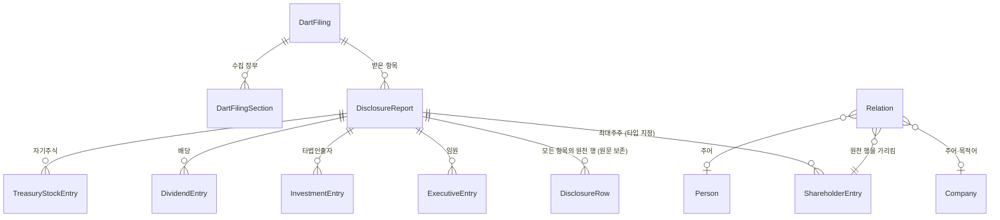

# 3단계 설계 — 정기보고서 주요정보와 지배구조 그래프 (초안 v2, 리뷰용)

> 상태: **리뷰 대기**. v1(최대주주·임원·출자 3종)에 대한 답을 반영해 **"가능한 모든 정보"** 로 넓혔고, 30개사 표본 조사로 고쳤다.
> 확정한 것: 관계 저장은 **C안**(원천 행은 종류별 테이블 + 공통 연결 목록), 수집 범위는 **사업보고서 5개년, 최신 연도부터**, 인물은 **근거가 있을 때만 자동 연결하고 "추정"으로 표시**.
> 상위 문서: [ontology-design.md](ontology-design.md) §3 관계, §5 저장, §6 단계별 계획.

## 1. 목표

- 정기보고서의 **항목별 정보를 모두** 받는다. 주주 · 임원 · 출자 · 배당 · 자기주식 · 주식 수 · 증자 · 직원 · 보수 · 감사인 · 채권 등이다.
- 그중 **관계**(누가 가졌나 · 누가 경영하나 · 어디에 넣었나)로 기업 중심 지배구조 그래프를 그린다. 연결된 기업으로 건너가며 탐색한다.
- 호출 한도(DART 키 1개, 하루 2만 회) 안에서 **먼저 틀을 잡을 만큼** 받고, 나머지는 매일 채운다.

## 2. 표본 조사 (2026-09-19)

**대상**: 30개사, FY2025 사업보고서, 정기보고서 주요정보 API 28종 전부. 모두 받아 약 815회 호출했고 실패는 0건이다.
- 대기업·지주: 삼성전자, SK하이닉스, 현대차, LG전자, LG, SK스퀘어, 삼성물산, 카카오, 네이버, 셀트리온, 포스코홀딩스, 한화에어로스페이스, 한국전력, 대한항공
- 금융: KB금융, 신한금융, 삼성생명, 삼성화재, 미래에셋증권, 기업은행
- 코스닥: 에코프로비엠, 알테오젠, HLB, 레인보우로보틱스, 펄어비스
- 특수: SK리츠, 교보16호스팩, 컬러레이·크리스탈신소재(외국), 탈로스(코넥스)

원본 JSON은 저장소에 넣지 않는다. 로컬 작업 폴더에만 있다.

### 2.1 API 28종 — 한 보고서에서 나오는 행 수

| 묶음 | API | 30개사 행 (최대/사) | 쓰임 |
|---|---|---|---|
| **지배구조** | 최대주주 현황 `hyslrSttus` | 519 (99) | 그래프: 주주 → 기업 |
| | 최대주주 변동현황 `hyslrChgSttus` | 116 (32) | 최대주주가 바뀐 이력 |
| | 임원 현황 `exctvSttus` | 1,175 (**305**) | 그래프: 인물 → 기업 |
| | 타법인 출자현황 `otrCprInvstmntSttus` | 2,026 (**409**) | 그래프: 기업 → 출자 대상 |
| | 사외이사 및 그 변동현황 | 33 (4) | |
| | 소액주주 현황 `mrhlSttus` | 33 (4) | |
| **주주환원·자본** | 배당에 관한 사항 `alotMatter` | 499 (60) | 배당성향, 주당배당 |
| | 자기주식 취득 및 처분 현황 | 416 (27) | 매입·소각 |
| | 주식의 총수 현황 | 130 (16) | 발행·유통 주식 수 |
| | 증자(감자) 현황 | 397 (74) | |
| **사람·보수** | 직원 현황 | 111 (12) | 인원, 평균 급여 |
| | 이사·감사 보수 5종, 미등기임원 보수, 개인별 보수 2종 | 약 450 | |
| **감사** | 감사인·감사의견, 감사용역, 비감사용역 | 510 | |
| **채무·자금** | 채무증권 발행실적 | 3,544 (**1,490**) | 금융사가 많음 |
| | 미상환 잔액 5종 (기업어음·단기사채·회사채·신종자본·조건부자본) | 495 | |
| | 공모·사모자금 사용내역 | 279 | |

### 2.2 알게 된 것 — 설계가 여기서 나온다

1. **"자료 없음"도 정상 응답으로 온다.** 스팩·리츠·외국 기업도 28종 모두 `000 정상`이다. 대신 값이 전부 `-`인 **빈 줄**을 준다(미상환 잔액은 회사마다 3행). 모든 값이 `-`인 행은 저장하지 않고 개수만 센다.
2. **합계 행이 섞여 온다.** `계`, `합계`, `합 계`, `소계`, `총계`. 합계 행은 버리지 않고 `isTotal`로 표시한다.
3. **금액 단위가 API마다 다르다.** 가장 중요한 발견이다.
   - 타법인출자: 보고서 원문은 `445,244`(단위: 백만원)인데 API는 `445,244,000,000`을 준다. **원으로 바꿔서 준다.**
   - 배당: **바꾸지 않는다.** 행 이름에 단위가 있다: `(연결)당기순이익(백만원)`, `주당액면가액(원)`.
   - 감사 보수: `8,100`은 백만원으로 보인다. 원문 대조가 필요하다.
   - 그래서 API마다 단위 규칙을 코드에 명시하고, **표본으로 원문과 대조해 확인한 API만 원 단위로 바꾼다.** 확인하지 못한 값은 숫자와 원문 단위를 함께 저장한다.
4. **외국 기업은 통화가 섞인다.** 비고에 `RMB 연간 급여 총액 : 2,262,221`처럼 적는다. 통화를 확정할 수 없는 금액은 원으로 바꾸지 않는다.
5. **표기가 제각각이다.** 지분율은 `8.51`과 `20.07%`가 섞여 있고, 재직기간은 `10개월`과 `10`이 섞여 있다. 기수는 `제57기 (당기)`로 오고, 사람 이름에 공백이 들어간 경우도 있다(`이 재 용`, 삼성물산).
6. **식별자가 없다.** 주주·출자 대상·임원 모두 **이름만** 온다. 출생년월은 임원 현황에만 있다.
7. **관계 문구도 제각각이다.** `최대주주의 특수관계인`, `친인척`, `발행회사 임원`, `계열회사 임원(SK(주))`, `계열비영리법인` 등. 원문 그대로 저장한다.
8. **공시 원본 파일(`document.xml`)도 쓸 만하다.**
   - 보고서 1건을 **1회 호출**로 통째로 준다(삼성전자 0.8MB zip, XML 3개).
   - 표에 필드 코드가 붙어 있다(`ACODE="SH5_BGN_CNT"` 등). 삼성전자 문서에 코드가 붙은 추출용 표가 107개 있었다.
   - 표마다 단위가 적혀 있다(`(단위 : 주, 백만원)`). 4단계 AI 추출에 쓸 본문도 여기 있다.
   - **정정공시의 접수번호로는 파일이 없을 수 있다.** KB금융의 `20260619000667`은 `014 파일이 존재하지 않습니다`였다.

### 2.3 이름 → 기업 연결률 (표본 실측)

§5.1 규칙(법인 형태·각주·공백 제거 후 정확히 한 곳과 같음)으로 맞춰 봤다.

| 대상 | 행 | 상장사 2,756곳과 연결 | DART 전체 법인 11.9만 곳과 연결 (이름이 유일할 때) |
|---|---|---|---|
| 최대주주 (합계 제외) | 451 | 21 (5%) | 36 (8%) — 이름이 같은 곳이 여럿인 경우 9 |
| 출자 대상 | 1,990 | 135 (7%) | **489 (25%)** — 이름이 같은 곳이 여럿인 경우 28 |

- 최대주주는 대부분 **사람**이라 기업 연결률이 낮은 것이 정상이다.
- 출자 대상은 **비상장 국내 법인**(세메스, 삼성전자서비스 등)이 많다. 그래서 상장사만 보면 7%지만, DART가 고유번호를 준 비상장 법인까지 보면 25%가 된다. 나머지는 해외 법인(`SDMA`), 펀드·조합이다 → §8-1.

## 3. 원칙 적용

- **원천 행은 그대로 사실로 남긴다.**
  - 이름·관계·비고는 원문 그대로 둔다.
  - 숫자는 스키마 타입(수량·금액 BigInt, 비율 double, 날짜 DateTime)으로 바꾸고, 해석할 수 없으면 비운다.
  - 단위를 확인하지 못한 금액은 원 단위로 바꾸지 않는다(§2.2-3).
- **연결은 따로, 근거와 함께.** "이 이름 = 이 기업 / 이 사람"은 우리의 판단이므로, 무엇으로 연결했는지(`linkBasis`)를 함께 저장한다. 연결은 호출 없이 DB만으로 다시 계산할 수 있다.
- **추정은 추정이라고 보여준다.** 인물 연결 중 근거가 간접적인 것은 화면에 점선과 "추정"으로 표시하고, 틀리면 끊을 수 있게 한다(§5.2).
- **정정공시는 덮어쓰지 않는다.** 2단계 재무와 같이 새 보고서를 추가하고 이전 것을 `supersededBy`로 가리킨다.

## 4. 데이터 모델 — C안



세 층으로 나눈다.

### 4.1 원천 층 — 28종 모두, 원문 그대로

| 모델 | 설명 |
|---|---|
| **DartFilingSection** | 수집 장부: 정기보고서(`DartFiling`) × 항목(`DartSection` enum 28종)의 상태(pending/stored/noData/failed), 재시도 횟수, 오류 |
| **DisclosureReport** | 보고서 1건 × 항목 1개. 접수번호, 사업연도, 결산기준일(`stlm_dt`), 출처, 행 수, 빈 줄 수, `supersededBy` |
| **DisclosureRow** | 응답 한 행을 **원문 JSON 그대로**(`fields`), 응답 순서(`ord`), 합계 행 여부 |

- 28종마다 테이블을 만들지 않는다. 원천 층은 **모든 항목을 한 형식으로** 받아 둔다. 아무것도 버리지 않고, 새 항목을 늘려도 스키마를 바꾸지 않는다.
- 수집 비용(호출)은 여기서 한 번만 든다. 아래 두 층은 이 행들에서 **호출 없이** 만든다.

### 4.2 타입 층 — 화면·쿼리에 쓰는 항목만

원천 행을 스키마 타입으로 바꾼 테이블이다. **숫자로 거르거나 그래프에 쓰는 항목**부터 만든다.

| 모델 | 원천 | 핵심 필드 |
|---|---|---|
| **ShareholderEntry** | 최대주주 현황 | holderName(공백 정리), relation(원문), stockKind, 기초·기말 주식 수·지분율, remark, isTotal, holderCompany / holderPerson / linkBasis |
| **ExecutiveEntry** | 임원 현황 | name, sex, birthYear/Month, position, registration(사내·사외·기타비상무·미등기·기타), fullTime, duties, career, relationToLargestHolder, tenureMonths, termEndDate, person |
| **InvestmentEntry** | 타법인출자 | investeeName, purpose, 최초 취득일·금액, 기초·증감·기말(수량·지분율·장부가·평가손익), 대상의 총자산·순이익(원), isTotal, investeeCompany / linkBasis |
| **DividendEntry** | 배당 | 항목(주당배당금·배당성향·배당수익률 …), stockKind, 당기·전기·전전기 값, **단위(원·백만원·%)** |
| **TreasuryStockEntry** | 자기주식 | 취득 방법(3단계), stockKind, 기초·취득·처분·소각·기말 수량 |

- 나머지 항목(보수·직원·감사·채권 등)은 원천 층에만 두고, 화면이 필요해질 때 타입 테이블을 더한다.
- 타입 층은 원천 층에서 다시 만들 수 있으므로, 규칙을 고치면 지우고 다시 만든다.

### 4.3 연결 층 — 공통 `Relation` (그래프 탐색용 색인)

| 필드 | 설명 |
|---|---|
| subject | Company 또는 Person, 또는 이름뿐인 노드(`subjectName`) |
| predicate | `SHAREHOLDER_OF` · `EXECUTIVE_OF` · `INVESTS_IN` (4단계에서 `SUPPLIES_TO` 등을 더함) |
| object | Company 또는 이름뿐인 노드 |
| asOf | 결산기준일 |
| weight | 대표 수치 하나(지분율 %). "20% 이상" 같은 필터와 그래프 굵기에 쓴다 |
| source | 출처 공시 |
| factTable, factId | 원천 행(타입 층)을 가리킴 — 자세한 값은 거기서 본다 |
| extractedBy | api / ai / manual |
| status | verified(API) / draft(AI 추출, 추정 연결) / rejected(사람이 끊음) |

- 3단계의 `Relation` 행은 **타입 층에서 자동으로 만든다**(status = verified). 인물 추정 연결만 draft다.
- 4단계 AI 관계는 같은 테이블에 status = draft와 인용문으로 들어간다.
- "두 단계 안에 닿는 모든 기업" 같은 탐색은 이 테이블 하나로 한다.

설계 문서 §5의 "엣지는 공통 relation 테이블(속성 JSON)"은 이 세 층 구조로 바꾼다(구현 PR에서 반영).

## 5. 연결 규칙 (엔티티 해석)

### 5.1 이름 → 기업

1. 이름을 정규화한다: 법인 형태(`주식회사`, `㈜`, `(주)`, `(유)`, `유한회사`), 각주(`(주1)`, `(*1)`, `*`), 알려진 꼬리표(`(특별계정)`), 공백을 떼고 영문은 소문자로 바꾼다.
2. 정규화한 이름이 **정확히 한 곳**과 같으면 연결한다. 여럿이면 잇지 않는다.
3. 맞출 범위는 §8-1에서 정한다(상장사만, 또는 DART 고유번호가 있는 비상장 법인까지).
4. 연결되지 않은 이름은 그 보고서 안의 **이름뿐인 노드**로 남는다(해외 법인, 펀드·조합 등).
5. 전체 수집 뒤 연결되지 않은 이름 상위 목록을 보고 규칙을 보강하고, 이 문서에 기록한다.

### 5.2 이름 → 인물

| 경우 | 처리 | 표시 |
|---|---|---|
| 임원 (출생년월 있음) | (이름, 출생년월)로 `Person`을 찾거나 만든다. 다른 회사 임원이어도 같으면 같은 사람 | 확정 |
| 주주 이름 = **같은 보고서**의 임원 한 명과 같은 이름 | 그 임원의 `Person` | 확정 |
| 주주 이름이 **지분으로 서로 연결된 회사들**(§5.1로 이어진 기업끼리의 묶음)의 주주 명단에 함께 나오고, 관계 문구가 최대주주 본인·특수관계인·친인척 계열 | 같은 사람으로 본다 | **추정** (점선, 끊을 수 있음) |
| 그 밖 | 잇지 않는다. 이름만 남는다 | — |

- 이름 비교 전에 공백을 뗀다(`이 재 용` = `이재용`).
- 예: "이재용"은 삼성전자(특수관계인 1.65%), 삼성생명(특수관계인 10.44%), 삼성화재(특수관계인 0.10%), 삼성물산(최대주주 본인 19.76%)의 주주다. 이 회사들은 서로 지분으로 이어져 있으므로 **추정**으로 하나가 된다.
- 반대로 서로 연결되지 않은 두 코스닥 회사의 "김영수"는 합치지 않는다.
- 사람이 모든 연결을 검토할 필요는 없다. 추정 연결만 점선으로 보이고, 틀린 것을 보면 **끊기**(status = rejected)만 하면 된다. 끊은 기록은 다시 계산해도 유지된다.

## 6. 수집

### 6.1 호출 계산

한 보고서를 전부 받으려면 **28회**가 든다.

| 범위 | 사업보고서 | 28종 전부 | 핵심 9종만¹ | 원본 파일만 |
|---|---|---|---|---|
| FY2025 | 약 2,700건 | 7.6만 회 (4.2일) | 2.4만 회 (1.4일) | 2,700회 |
| 5개년 | 약 13,500건 | 37.8만 회 (21일) | 12.2만 회 (6.8일) | 13,500회 (0.8일) |

¹ 핵심 9종: 최대주주, 최대주주 변동, 소액주주, 임원, 타법인출자, 배당, 자기주식, 주식 총수, 증자(감자).
일수는 하루 18,000회 기준이다. 2단계 재무 백필은 약 74,000회가 남아 있고 9/24경 끝난다.

### 6.2 제안하는 순서 — "틀 먼저"

| 순서 | 무엇 | 호출 | 결과 |
|---|---|---|---|
| ① | 재무 백필 마무리 (진행 중) | ~74,000 | |
| ② | **FY2025 핵심 9종** | ~24,000 | 전 상장사의 지배구조 그래프와 주주환원 화면이 완성된다 — **틀** |
| ③ | FY2025 나머지 19종 | ~51,000 | 최신 연도는 전부 채워진다 |
| ④ | FY2021~2024 핵심 9종 → 나머지 | ~300,000 | 이력 (최신 연도부터 거꾸로) |

- 매일 새 사업보고서가 나오면 받는다. 사업보고서가 몰리는 3월 말(약 2,700건)에는 핵심 9종이 약 1.4일, 28종 전부가 약 4일 걸린다. 그래서 새 보고서는 핵심 9종부터 받는다.
- ③·④는 원본 파일로 대체할 수 있다(§8-2). 4단계 AI 추출에 **어차피 원본 파일이 필요**하므로, 원본 파일을 받으면 같은 호출로 두 가지를 얻는다.

### 6.3 호출 한도 늘리기

- **DART 키를 여러 개 받는 방법은 쓰지 않는다.** 이용약관 19조 5항은 "회원은 ID 및 인증키를 2개 이상 발급 받을 수 없습니다"이고, 위반하면 20조에 따라 해지될 수 있다. 수집 전체가 키 하나에 걸려 있다.
- 공공데이터포털은 병목이 아니다(5년치 시세 3,749회). 필요하면 개발계정을 **운영계정으로 전환 신청**하는 정식 경로가 있다.
- 호출을 줄이는 방법은 원본 파일(§2.2-8, §8-2)이다.

## 7. 화면

기업 상세에 탭 두 개를 더한다. 데이터가 생긴 뒤에만 보인다.

**지배구조 탭**
```
 주주 (최대주주 및 특수관계인 19.84%)       이 회사              출자 (경영참여 102곳)
 삼성생명보험 8.51% ────────────────────▶ ┌────────┐ ──────▶ 삼성전기 23.7%
 삼성물산 5.05% ────────────────────────▶ │ 삼성전자 │ ──────▶ 삼성SDI 19.4%
 이재용 1.65% ┄┄(추정: 삼성물산·삼성생명 주주와 동일인)┄▶ └────────┘ ──────▶ SDMA 75.0% (이름뿐)
                                              ▲
                          이 회사에 출자한 기업 (다른 회사 보고서에서 역으로)
 표: 최대주주 및 특수관계인 · 최대주주 변동 · 임원(등기/미등기, "이 회사는 등기임원만 공시" 안내) · 타법인출자
```
- 노드를 누르면 그 기업·인물로 건너간다. 인물 페이지에는 그 사람이 주주·임원인 모든 회사가 나온다.

**주주환원 탭**
- 배당(주당배당금 · 배당성향 · 시가배당률 추이), 자기주식(매입 · 처분 · 소각), 주식 총수(발행 · 유통 · 자사주).
- 2단계 재무 · 시세와 합쳐서 계산하는 값은 계산식과 함께 보여 준다.

**나중에**: 보수 · 직원 · 감사 · 채권은 ③ 수집 뒤 개요 탭 카드나 별도 탭으로 둔다. 기업집단 전체 네트워크(여러 회사를 한 번에 그리는 그래프)는 인물 추정 연결이 쌓인 뒤에 한다.

## 8. 정할 것

1. **비상장 법인도 노드로 둘까?**
   - 출자 대상의 대부분이 비상장 국내 법인이다. DART는 이들에게도 고유번호를 준다(전체 11.9만 곳).
   - 이름이 유일하게 맞는 비상장 법인을 **"비상장 기업"** 으로 만들면 출자 연결이 7%에서 25%로 늘어난다. 이 기업은 고유번호와 이름만 있고, 개황은 필요할 때 받는다. 호출은 늘지 않는다(`corpCode.xml`은 이미 받는 파일).
   - 추천: 둔다. 기업 목록·시장 화면은 지금처럼 상장사만 보여 준다.
2. **③·④(나머지 항목, 과거 연도)를 API로 받을까, 원본 파일로 받을까?**
   - API: 28회/건, 정돈된 값. 5개년이면 약 3주.
   - 원본 파일: 1회/건, 4단계 본문도 같이 얻는다. 표를 필드 코드로 읽는 파서가 필요하고, 값을 API와 대조해 검증해야 한다.
   - 추천: ②(핵심 9종 FY2025)는 API로 받는다. 그다음 원본 파일 파서를 만들어 FY2025에서 **API 값과 같게 읽히는지 대조**하고, 같으면 ③·④와 4단계는 원본 파일로 받는다.
