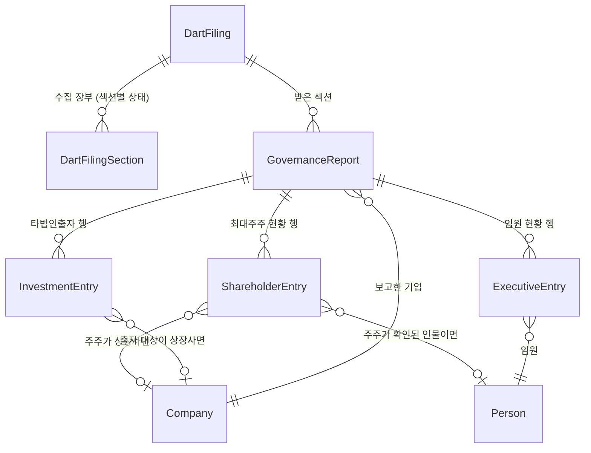

# 3단계 설계 — 지배구조 그래프 (초안, 리뷰용)

> 상태: **리뷰 대기**. 코드를 짜기 전에 스키마와 규칙을 확정한다. §8 "정할 것"에 답을 받으면 구현을 시작한다.
> 상위 문서: [ontology-design.md](ontology-design.md) §3 관계, §6 단계별 계획.

## 1. 목표

기업 하나를 열면 **누가 이 회사를 가졌고, 누가 경영하고, 이 회사는 어디에 돈을 넣었는지**를 한 화면에서 보고, 연결된 상장사로 건너가며 탐색한다.

| 질문 | 원천 (DART 정기보고서 주요정보) | 온톨로지 관계 |
|---|---|---|
| 누가 가졌나 | 최대주주 현황 `hyslrSttus` | `LARGEST_SHAREHOLDER_OF` (주주 → 기업) |
| 누가 경영하나 | 임원 현황 `exctvSttus` | `EXECUTIVE_OF` (인물 → 기업) |
| 어디에 넣었나 | 타법인출자 현황 `otrCprInvstmntSttus` | `INVESTS_IN` (기업 → 출자 대상) |

세 API 모두 `corp_code` + `bsns_year` + `reprt_code`로 부르고, 응답 행마다 정기보고서 접수번호(`rcept_no`)가 붙는다. 2단계 재무처럼 **정기보고서 1건 = 출처 1개**로 묶을 수 있다.

## 2. 원천 실측 (2026-09-19, FY2025 사업보고서)

| | 삼성전자 | 에코프로비엠 | 카카오 |
|---|---|---|---|
| 최대주주 현황 행 | 27 | 18 | 92 |
| 임원 현황 행 | 9 (사내 3 · 사외 6) | 30 (**미등기 21** 포함) | 8 (사내 3 · 사외 5) |
| 타법인출자 행 | 134 | 12 | 64 |

응답을 보고 알게 된 것 — 설계가 여기서 나온다.

1. **식별자가 없다.** 주주·출자 대상은 이름만 온다. `corp_code`도 법인등록번호도 없다.
   - 이름 표기가 제각각이다: `삼성생명보험㈜`, `주식회사 에코프로이엠`, `Kakao piccoma Corp.`, 해외 법인 약칭 `SDMA`, `SEMA`, 각주 `카카오 성장나눔게임펀드 (주1)`, 줄바꿈 `삼성생명보험㈜\n(특별계정)`.
   - 우리 DB의 기업명도 `(주)카카오` 식이라 양쪽을 정규화해야 맞출 수 있다.
2. **인물 식별 정보가 API마다 다르다.**
   - 임원: 이름 · 성별 · **출생년월**(`1960년 12월`).
   - 최대주주: **이름뿐**. 삼성전자와 삼성물산의 주주 명단에 있는 "이재용"이 같은 사람이라는 근거가 응답에 없다.
3. **임원 범위가 회사마다 다르다.** 미등기 임원까지 내는 회사(에코프로비엠)와 등기 임원만 내는 회사(삼성전자·카카오)가 있다. "임원 수"를 회사끼리 비교하면 안 된다.
4. **합계 행이 섞여 온다.** 최대주주는 `계`(보통주·우선주 각각), 타법인출자는 `합계`.
5. **한 주주가 주식 종류별로 여러 행이다** (보통주·우선주).
6. **값은 문자열이다.** `"508,157,148"`, `"8.51"`, 없는 값은 `"-"`. 금액은 세 회사 모두 원 단위로 보인다(삼성전자의 삼성전기 지분 장부가 `445,244,000,000`). 다만 회사가 보고서에 쓴 단위를 DART가 원으로 바꿔 주는지는 문서로 확인하지 못했다 → §8-5.
7. 최대주주 변동 현황(`hyslrChgSttus`)은 변동이 없으면 `-`만 있는 행 1개가 온다. 3단계에는 넣지 않는다(연도별 최대주주 현황으로 변동을 알 수 있음).

## 3. 원칙 적용

- **원천 행은 그대로 사실로 남긴다.** 이름·관계·비고는 원문 그대로 둔다. 숫자는 스키마 타입(주식 수·금액 BigInt, 지분율 double, 날짜 DateTime)으로 정규화하고, 해석할 수 없으면 비운다. 합계 행도 버리지 않고 "합계 행"으로 표시해 둔다.
- **연결은 따로, 근거와 함께.** "이 이름 = 이 상장사/이 사람"은 원천 사실이 아니라 우리의 판단이다. 2단계의 `Security.linkBasis`처럼 **무엇으로 연결했는지**를 함께 저장한다. 근거가 없으면 잇지 않고 이름만 보여준다.
- **동명이인을 추측으로 합치지 않는다.** 인물은 출생년월이 있을 때만 같은 사람으로 본다. 나머지는 사람이 확인해 합친다(§5.2).
- **정정공시는 덮어쓰지 않는다.** 2단계 재무와 같이 새 보고서를 추가하고 이전 것을 `supersededBy`로 가리킨다.

## 4. 데이터 모델



### 4.1 수집 장부

**DartFilingSection** — 정기보고서 한 건(`DartFiling`, 2단계에서 이미 쌓는 장부) × 섹션 하나의 수집 상태.

| 필드 | 설명 |
|---|---|
| filing | `DartFiling` |
| section | `DartSection` enum: `largestShareholders` · `executives` · `investments` (나중에 배당·자기주식을 넣을 수 있게 열어 둔다) |
| status | `FilingFetchStatus` 재사용: pending · stored · noData · failed · unsupported |
| attempts, lastError, fetchedAt | 2단계와 같은 재시도 규칙 |

유일 인덱스는 (filing, section)이다. `DartFiling`에 섹션마다 상태 열을 붙이지 않고 행으로 둔다. 이유: 섹션이 늘어도 스키마를 바꾸지 않기 위해서다.

### 4.2 사실

**GovernanceReport** — 보고서 1건 × 섹션 1개. 2단계 `FinancialReport`에 해당한다.

| 필드 | 설명 |
|---|---|
| company, filing, section | |
| rceptNo, bsnsYear, reportCode | |
| settlementDate | 응답의 `stlm_dt` (결산기준일 — 관계의 `asOf`) |
| source | 공시 접수번호 출처. 같은 공시의 재무 출처와 같은 `Source`를 쓴다 |
| rowCount, invalidValueCount | 저장한 행 수, 해석하지 못해 비운 값 수 |
| supersededBy | 정정공시로 대체되면 새 보고서 |

**ShareholderEntry** — 최대주주 및 특수관계인 한 행.

| 필드 | 원천 | 비고 |
|---|---|---|
| ord | 응답 순서 | |
| holderName | `nm` | 원문 (줄바꿈만 공백으로) |
| relation | `relate` | 원문: 최대주주 본인 / 최대주주의 특수관계인 / 계열회사 / 계열회사 임원 / 출연 재단 … |
| stockKind | `stock_knd` | 원문: 보통주 / 우선주 … |
| sharesBegin, ratioBegin | `bsis_posesn_stock_co`, `…_qota_rt` | BigInt, double(%) |
| sharesEnd, ratioEnd | `trmend_posesn_stock_co`, `…_qota_rt` | |
| remark | `rm` | |
| isTotal | `nm == "계"` | 합계 행 |
| holderCompany, holderPerson, holderLinkBasis | — | §5 연결 결과. 없으면 이름만 |

**ExecutiveEntry** — 임원 한 행.

| 필드 | 원천 | 비고 |
|---|---|---|
| name, sex | `nm`, `sexdstn` | |
| birthYear, birthMonth | `birth_ym` "1960년 12월" | 해석 못 하면 비움 |
| position | `ofcps` | 원문 (부회장, 사장, 사외이사 …) |
| registration | `rgist_exctv_at` | enum: 사내이사 · 사외이사 · 기타비상무이사 · 미등기 · 기타(원문 보존) |
| fullTime | `fte_at` | 상근 여부 |
| duties, career | `chrg_job`, `main_career` | 원문 |
| relationToLargestHolder | `mxmm_shrholdr_relate` | 원문 |
| tenureMonths, termEndDate | `hffc_pd`, `tenure_end_on` | "10개월", "2028년 03월 18일" |
| person | — | §5.2. 출생년월이 있으면 항상 연결 |

**InvestmentEntry** — 타법인출자 한 행.

| 필드 | 원천 | 비고 |
|---|---|---|
| investeeName | `inv_prm` | 원문 |
| purpose | `invstmnt_purps` | 원문: 경영참여 / 단순투자 / 일반투자 … |
| firstAcquiredOn, firstAcquiredAmount | `frst_acqs_de`, `frst_acqs_amount` | |
| sharesBegin, ratioBegin, bookValueBegin | `bsis_blce_*` | |
| sharesChange, amountChange, valuationChange | `incrs_dcrs_*` | 증가·감소·평가손익 |
| sharesEnd, ratioEnd, bookValueEnd | `trmend_blce_*` | |
| investeeTotalAssets, investeeNetIncome | `recent_bsns_year_fnnr_sttus_*` | 출자 대상의 최근 사업연도 재무 |
| isTotal | `inv_prm == "합계"` | |
| investeeCompany, investeeLinkBasis | — | §5.1 |

**Person** — 인물. **출생년월이 있는 임원에게서만 만든다.**

| 필드 | 설명 |
|---|---|
| name, birthYear, birthMonth, sex | 유일 인덱스는 (name, birthYear, birthMonth) |

### 4.3 관계는 어디에 있나 — 설계 문서 §5 변경 제안

설계 문서 §5는 "엣지는 공통 `relation` 테이블(속성 JSON)"이라고 되어 있다. 이 부분을 바꾸려 한다.

- 3단계 관계는 **위의 사실 테이블 자체가 엣지**다. 행 하나 = 관계 하나이고, 주어·목적어·기준일(`settlementDate`)·출처가 이미 있다.
- 지분율·장부가처럼 **숫자로 걸러야 하는 속성**이 JSON 안에 들어가면 "지분 20% 이상 출자 대상" 같은 쿼리를 할 수 없다.
- 공통 `relation` 테이블은 4단계(AI 추출: 공급·경쟁·제품)와 5단계(테마)에 쓴다. 그쪽은 status(draft/verified)·인용문·신뢰도가 필요하고 종류가 계속 늘기 때문이다.
- 그래프 화면은 두 곳(사실 테이블 + relation)에서 엣지를 읽어 합친다.

## 5. 연결 규칙 (엔티티 해석)

### 5.1 이름 → 상장사

1. 양쪽 이름을 정규화한다.
   - 법인 형태를 뗀다: `주식회사`, `㈜`, `(주)`, `(유)`, `유한회사`.
   - 알려진 꼬리표를 뗀다: `(특별계정)`.
   - 각주 표시를 뗀다: `(주1)`, `(*1)`, `*`.
   - 공백을 없애고 영문은 소문자로 바꾼다.
2. 정규화한 이름이 **상장사 한 곳**과 정확히 같으면 연결한다(`linkBasis = companyName`). 두 곳 이상이면 잇지 않는다.
3. 출자 대상 행은 `purpose`와 무관하게 같은 규칙을 쓴다.
4. 연결되지 않은 이름은 **엔티티를 만들지 않는다.**
   - 설계 문서 §3의 "이름만 가진 미확인 Company"를 만들면 `Company`의 키(`corpCode`)가 비게 된다. 그래서 그 대신 사실 행에 이름으로 남기고, 화면에서 "이름만 있는 노드"로 그린다.
   - 비상장사(`SDMA`, 펀드·조합 등)가 여기에 해당한다.
5. 정규화 규칙은 전체 수집 뒤 **연결되지 않은 이름 상위 목록**을 보고 보강한다. 보강한 규칙은 이 문서에 기록한다.

### 5.2 이름 → 인물

| 경우 | 처리 |
|---|---|
| 임원 (출생년월 있음) | (이름, 출생년월)로 `Person`을 찾거나 만든다. 다른 회사의 임원이어도 이 셋이 같으면 같은 사람으로 본다 |
| 주주 이름 = **같은 보고서**의 임원 중 한 명과 같은 이름 | 그 임원의 `Person`에 연결 (`linkBasis = executiveSameFiling`). 같은 이름의 임원이 둘이면 잇지 않는다 |
| 그 밖의 주주 인물 | 잇지 않는다. 이름만 남는다 |

그래서 "삼성전자의 주주 이재용"과 "삼성물산의 주주 이재용"은 **자동으로 합쳐지지 않는다.** 기업집단의 소유 구조를 보려면 이 연결이 핵심이다 → §8-3에서 방법을 고른다.

## 6. 수집

- **대상**: `DartFiling` 장부에 이미 있는 상장사 정기보고서. 3단계에서는 **사업보고서만** 받는다(§8-2). 분기·반기보고서에도 같은 항목이 있지만(삼성전자 2026 반기보고서 임원 8행), 지배구조는 분기마다 크게 바뀌지 않으므로 연 1회로 시작한다.
- **흐름**: 2단계 재무와 같다.
  - 받지 않은 (보고서, 섹션)을 최신순으로 받는다.
  - 응답의 `rcept_no`·`corp_code`를 요청과 대조한다.
  - 정정공시면 이전 보고서를 대체 표시한다.
  - 저장이 끝나면 연결(§5)을 돌린다. 연결은 호출 없이 DB만으로 다시 돌릴 수 있어서, 규칙을 고치면 전체를 다시 연결한다.
- **호출 예산**: 보고서 1건 = 3회.

  | 범위 | 호출 | DART 한도 기준 |
  |---|---|---|
  | FY2025 사업보고서 (~2,700건) | 약 8,100회 | 하루 한도의 절반 |
  | 5개년 사업보고서 (~13,500건) | 약 40,500회 | 약 2.3일 |

  재무 백필이 아직 약 74,000회 남았다(9/24경 끝날 예정). 3단계 구현이 끝날 무렵이면 백필도 거의 끝나 있을 것이다. 3단계 수집은 같은 DART 예산 장부(`ApiCallUsage`)를 쓰고, **재무 백필이 끝난 뒤 매일 남는 한도**로 돈다(§8-4).
- **스케줄**: 매일 재무 수집(18:30) 뒤에 이어서 새 사업보고서의 지배구조를 받는다.

## 7. 화면

기업 상세에 **지배구조 탭**을 더한다(데이터가 생긴 뒤에만 보인다).

```
[헤더: 삼성전자 · 핵심 지표]
[개요] [재무] [지배구조]

 주주 (최대주주 및 특수관계인 19.84%)       이 회사              출자 (경영참여 102곳)
 ─────────────────────────────           ┌────────┐         ───────────────────
 삼성생명보험 8.51% ────────────────────▶ │ 삼성전자 │ ──────▶ 삼성전기 23.7%
 삼성물산 5.05% ────────────────────────▶ │        │ ──────▶ 삼성SDI 19.4%
 이재용 1.65% · 홍라희 1.49% …            └────────┘ ──────▶ SDMA 75.0% (비상장·이름만)
                                              ▲
                          이 회사에 출자한 상장사 (다른 회사 보고서에서 역으로)

 표: 최대주주 및 특수관계인 · 임원(등기/미등기 구분, 범위 안내) · 타법인출자 — 모두 출처 공시 링크
```

- 가운데에 이 회사를 두고, 왼쪽에 주주, 오른쪽에 출자 대상을 둔 **방사형 그래프**다. 상장사 노드를 누르면 그 회사의 지배구조 탭으로 건너간다.
- **역방향 엣지**도 보여 준다: 다른 상장사의 타법인출자·최대주주 행 가운데 이 회사로 연결된 것.
- 지분율은 보통주 기준으로 그리고, 우선주는 표에서 보여 준다.
- 기업개황 개요 탭에는 요약만 둔다: 최대주주와 지분율, 등기 임원 수, 경영참여 출자 수.
- 기업집단 전체 네트워크(여러 회사를 한 번에 보는 힘-배치 그래프)는 3단계 이후로 미룬다. 그전에 인물 연결(§8-3)이 정리되어야 쓸모가 있다.

## 8. 정할 것

1. **관계 저장 방식** — §4.3 제안대로 3단계는 사실 테이블이 곧 엣지이고, 공통 `relation`은 4·5단계용으로 둘까? (추천)
   아니면 설계 문서대로 처음부터 모든 관계를 `relation` 한 테이블에 넣을까?
2. **수집 범위** — 사업보고서 5개년(추천: 최신 연도부터 받아 화면은 바로 쓸 수 있음) / 최신 사업보고서만 / 분기·반기까지.
3. **주주 인물 연결** — 이름만 있는 주주를 어떻게 같은 사람으로 볼까?
   - (a) 자동으로 잇지 않고, 화면에서 "같은 사람" 후보(같은 이름이 여러 회사 주주로 나옴)를 보여 준 뒤 **사람이 확인해 합친다**. 합친 기록은 `manual` 출처로 남긴다. (추천, 원칙 3·4에 맞음)
   - (b) 같은 기업집단 안에서는 동명이인이 없다고 보고 자동으로 합친다(빠르지만 추측).
   - (c) 3단계에서는 잇지 않고 넘어간다.
4. **예산 순서** — 재무 백필이 끝난 뒤에 지배구조를 받기(추천) / 지배구조 최신 연도(8,100회)를 먼저 받고 백필을 반나절 미루기.
5. **금액 단위 확인** — 타법인출자 금액이 원 단위인지 확정하는 방법. 구현 때 표본 기업들의 장부가 합계를 재무제표의 관계기업·종속기업 투자 계정과 맞춰 보고, 어긋나는 회사가 있으면 저장 전에 멈춘다. 이 방식으로 괜찮을까?
6. **주주환원 데이터를 같이 받을지** — 버틀러의 "주주환원"에 해당하는 배당(`alotMatter`)과 자기주식(`tesstkAcqsDspsSttus`)은 같은 API 묶음이라 장부(§4.1 `DartSection`)에 섹션만 더하면 된다(보고서당 2회 추가). 3단계에 같이 넣을까, 따로 할까?
